<picture>
  <source media="(prefers-color-scheme: dark)" srcset="assets/header-dark.svg">
  <source media="(prefers-color-scheme: light)" srcset="assets/header-light.svg">
  
</picture>

 

I'm an Electronics & Communication student who likes building the whole thing:
the firmware on the microcontroller, the circuit it drives, and the dashboard
on the other end of the serial cable. Most of my work is in embedded C on
STM32 and ESP32, closed-loop control, and small Linux boxes that tie sensors
together.

- Chair, **IEEE Signal Processing Society** Student Branch Chapter, RIT Bengaluru
- Embedded systems intern at **MicroLOGIX Embedded Controls** (Aug – Sep 2025)
- Looking for **embedded / embedded Linux internships**

## Tech

<table>
  <tr>
    <td><b>Languages</b></td>
    <td>
      
      
      
      
      
    </td>
  </tr>
  <tr>
    <td><b>Hardware</b></td>
    <td>
      
      
      
      
    </td>
  </tr>
  <tr>
    <td><b>Interfaces</b></td>
    <td>
      
      
      
    </td>
  </tr>
  <tr>
    <td><b>Tools</b></td>
    <td>
      
      
      
      
      
    </td>
  </tr>
</table>

## Projects

<table>
  <tr>
    <td width="50%" valign="top">
      <h3><a href="https://github.com/Gautham-Dev007/pid-testbench">PID Temperature Testbench</a></h3>
      Three controllers on one heated block, compared on the same hardware:
      fixed-gain PID, Ziegler–Nichols gains from a relay autotune, and
      gain-scheduled adaptive PID. PT100 over SPI, OLED, live PyQt5 dashboard.
        
      <code>STM32G070RB</code> <code>HAL</code> <code>MAX31865</code> <code>PyQt5</code>
    </td>
    <td width="50%" valign="top">
      <h3><a href="https://github.com/Gautham-Dev007/IoT_Pi32">IoT_Pi32</a></h3>
      ESP32-S3 and ESP8266 sensor nodes reporting to a Raspberry Pi hub over
      MQTT. Keeps every reading through Wi-Fi drops and power cuts, learns
      local rain and temperature trends, OTA updates, e-ink display and an
      installable web app.
        
      <code>ESP32-S3</code> <code>Raspberry Pi 4</code> <code>MQTT</code> <code>Python</code>
    </td>
  </tr>
  <tr>
    <td width="50%" valign="top">
      <h3><a href="https://github.com/Gautham-Dev007/PID-AutoTuning">PID-AutoTuning</a></h3>
      The Arduino version that started it: DS18B20 sensing, TRIAC heater drive
      through a zero-cross opto, self-tuning PI with Ziegler–Nichols, and a
      Python GUI with over-temperature alarms and data logging.
        
      <code>Arduino</code> <code>DS18B20</code> <code>Matplotlib</code>
    </td>
    <td width="50%" valign="top">
      <h3><a href="https://github.com/Gautham-Dev007/Internship">Internship work</a></h3>
      From MicroLOGIX: SMTP e-mail alerts from an STM32 over Wi-Fi, USB-camera
      face recognition with cloud upload, a camera-based visual pointer, and a
      Figma UI for an industrial control panel.
        
      <code>STM32</code> <code>Embedded C</code> <code>OpenCV</code> <code>Figma</code>
    </td>
  </tr>
</table>

Also built: an ESP32 Wi-Fi mesh for environmental monitoring (shown at
Microsoft), and a helmet-detection system with an STM32 and YOLOv8n.

## Contact

